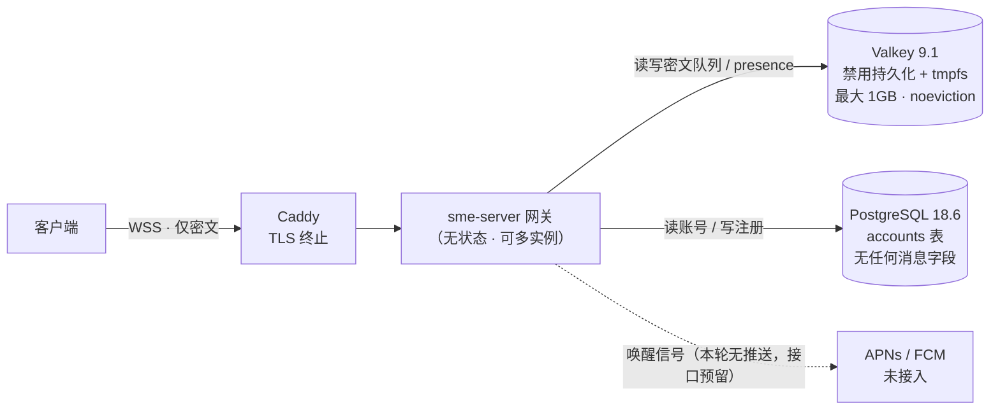

# sme 基础设施规格

> 状态 v0.1（随 `plan.md` v0.6 定稿）
> 原则：**能不加的组件就不加**。持久层只放公开的账号数据；易失层只放密文；两者绝不交叉。

## 1. 组件清单

| 组件 | 版本（pin） | 作用 | 能否落盘 |
| --- | --- | --- | --- |
| **PostgreSQL** | `postgres:18.6-alpine` | 账号表（唯一业务表） | ✅ 可以，只放公开数据 |
| **Valkey** | `valkey/valkey:9.1.2-alpine` | 消息队列 / presence / prekey / 登录挑战 / 限流 | ❌ **绝对禁止** |
| **Caddy** | `caddy:2-alpine`（上线前 pin 补丁号） | TLS 终止 + 反向代理 | ✅ 证书与访问日志（不含消息） |
| **网关** | 本项目 `sme-server`（Rust + axum） | WebSocket、认证、路由、队列读写 | ❌ 不落盘 |

**明确不引入**：消息中间件（Kafka / RabbitMQ / NATS）、可观测性栈（Prometheus / Grafana / OTel / SaaS）、对象存储、Kubernetes、密钥管理服务、客户端数据库。

理由见 `plan.md` §12：生产级 MQ 在设计上就是「持久化的消息日志」，与「消息零落盘」正面冲突；我们的消息传递只有一件事——把密文送到收件人当前连接所在的网关。

## 2. 职责边界与三道防线



| 目标 | 防线 |
| --- | --- |
| Postgres 永不出现消息 | ① 迁移审查 + schema 断言（**I1**）；② CI 字段名门禁（禁词表）；③ 金丝雀扫 DB dump（**I9**） |
| Valkey 永不落盘 | ① 启动自检 `CONFIG GET save appendonly` 不通过即拒绝启动（**I7**）；② 数据目录挂 tmpfs；③ compose 配置 lint；④ 重启后队列为空的测试（**I8**） |
| 账号数据不进缓存 | 不把 Postgres 数据缓存进 Valkey。Postgres 足够快，两级真相源会长歪 |

## 3. Postgres：数据模型

只有一张业务表（其余是 sqlx 的 `_sqlx_migrations`）：

```sql
CREATE TABLE accounts (
    account_id     TEXT        PRIMARY KEY,   -- 128-bit 随机，base32 26 字符（D16）
    ed25519_pub    BYTEA       NOT NULL,      -- 32 字节，身份公钥
    curve25519_pub BYTEA       NOT NULL,      -- 32 字节，Olm 身份公钥
    kdf_salt       BYTEA       NOT NULL,      -- 16 字节，**客户端生成**（服务端无法挑弱盐）
    kdf_params     JSONB       NOT NULL,      -- {alg:"argon2id", v:19, m_cost, t_cost, p_cost}
    created_at     TIMESTAMPTZ NOT NULL DEFAULT now()
);
```

三条规定：

1. **CI 字段名门禁**：迁移文件与查询中不得出现 `message` / `content` / `body` / `payload` / `ciphertext` / `envelope` / `text` 等列名，命中即构建失败。
2. **不存时间行为数据**：没有 `last_seen` / `last_login` / `login_count`。在线状态只存在于 Valkey 的 TTL 键里，重启即消失。
3. **prekey 不落 PG**：一次性预密钥是短生命周期公开数据，放 Valkey（TTL 7 天）；客户端每次连接都会重新上传，丢失可由客户端自愈。

**备份与删除**：只备份 Postgres（按上面的 schema，它里面不可能有消息）。Valkey 不备份、不做快照、不配置持久化。删除账号 = `DELETE FROM accounts` 一条语句，没有级联，也没有需要清理的消息。

## 4. Valkey：键空间与语义

### 4.1 键命名（D17：全部 HMAC）

所有键与 Pub/Sub 频道名中的账号 ID 都替换为 `h = HMAC-SHA256(服务端密钥, account_id)` 的前 32 个十六进制字符。这样运维敲 `KEYS *`、监控抓慢查询、指标里都看不到「谁在等谁的消息」。

| 键 | 类型 | 内容 | TTL |
| --- | --- | --- | --- |
| `q:{h}` | Stream | 消息元数据 + 文本密文（每条约 100–500 字节） | 条目按时间裁剪，24h |
| `img:{h}:{msgid}` | String | 图片密文（≤1MB） | 24h |
| `p:{h}` | String | presence：网关实例 ID（心跳 20s 续期） | 60s |
| `pk:{h}` | Hash | 对端可取的一次性 prekey bundle | 7d |
| `ch:{nonce}` | String | 登录挑战（绑定 account_id） | 60s |
| `rl:*:{h}:{w}` | String | 限流计数器 | 按窗口 |

服务端密钥（用于 HMAC）由网关启动时从环境变量读取；轮换时只影响键名映射，历史上限内的队列会因此不可读——**轮换前先排空队列**。

### 4.2 消息队列语义（D1 + D7）

**为什么图片密文单独放兄弟键**：Stream 条目保持在 ~百字节量级，于是「扫一遍队列做配额检查」是廉价操作；同时图片字节能靠 TTL 自然回收，不需要维护容易漂移的字节计数器。

写入路径（发送方 → 收件人离线/在线均走同一条队列，无在线旁路）：

```
XADD q:{h} MAXLEN ~ 100 * meta...      # 文本密文在 meta 里；图片另有 img:{h}:{id}
（若含图片）SET img:{h}:{id} <payload> EX 86400
XTRIM q:{h} MINID <now-24h>            # 与条目一起做，用 Lua 保证原子
PUBLISH gw:{h(网关实例)} <唤醒提示>      # 只通知持有该连接的网关实例
```

读取与删除：网关 `XRANGE q:{h}` 读到本地连接上 → 写 socket → 收到客户端 **D-ack** 后用一个 Lua 脚本原子执行 `XDEL q:{h} <id>` + `DEL img:{h}:{id}`。

**队列是唯一事实来源，Pub/Sub 只负责降延迟**：Pub/Sub 是 at-most-once，通知丢了不要紧——接收方重连时排空 `q:{h}` 即可恢复。重复投递也安全：vodozemac 对已消费的消息密钥返回 `MissingMessageKey`，客户端 fail-closed 丢弃。

### 4.3 配额

| 项 | 值 | 说明 |
| --- | --- | --- |
| 单条文本 | ≤ 16 KB | 网关拒绝更大者 |
| 单张图片 | 压缩后 ≤ 1 MB | 客户端压缩（见 §7.3） |
| 每收件人条数 | ≤ 100 | `MAXLEN ~ 100` |
| 每收件人图片 | ≤ 10 张且 ≤ 12 MB | 推送前按 Stream 元数据求和校验，超出则拒绝 |
| 全局 | `maxmemory 1gb` + `noeviction` | 满了明确拒绝新消息，**不静默驱逐别人的消息** |
| 网关并发大消息 | ≤ 8 路在途 | 防止少量 1MB 消息吃光网关内存 |

被拒绝时发送方收到的错误是「服务器暂存已满，请稍后重试」——它只反映服务器负载，**不反映对方状态**（见 §4.5）。

### 4.4 容量估算

| 场景 | 占用 |
| --- | --- |
| 纯文本塞满一个收件人 | 100 × ~0.3KB ≈ 30 KB |
| 图片塞满一个收件人 | ≤ 12 MB（硬上限） |
| 1GB 可容纳 | 约 80 个「图片完全塞满」的收件人，或数十万个纯文本收件人 |

绝大多数用户打开应用即清空队列，实际上限远高于此。若将来不够，提高 `maxmemory` 或按用户分片即可，不需要改协议。

### 4.5 与「无状态感知」的一致性（D22）

发送方能拿到的只有 **Q-ack**（服务端已接管）。它永远无法知道对方是否收到、是否在线、是否读过——因为：

- 接收方的回执只发给服务端（**D-ack**），不转发给发送方；
- 附件同样走队列，**不存在"在线直传失败"这条旁路**（这是把图片当消息处理的附带收益）；
- 唯一会回给发送方的失败是「服务器暂存已满」，与对方状态无关。

### 4.6 故障语义

| 故障 | 后果 | 是否可接受 |
| --- | --- | --- |
| Valkey 重启 | 丢失 ≤24h 的未投递密文与 presence、prekey | 是（D1 已选择「宁可丢也不长期存」） |
| 网关重启 | 连接断开，客户端重连后自动排空队列 | 是 |
| Postgres 不可用 | 无法登录与注册；已登录会话照常收发 | 是（可降级运行） |
| 服务端 HMAC 密钥轮换 | 旧队列键不可读 | 需先排空（见 §4.1） |

## 5. 部署

```yaml
# docker-compose.yml（开发与单机自托管共用）
services:
  caddy:
    image: caddy:2-alpine
    ports: ["80:80", "443:443"]
    volumes: [./Caddyfile:/etc/caddy/Caddyfile:ro, caddy_data:/data]

  gateway:
    build: .
    environment:
      DATABASE_URL: postgres://sme:${POSTGRES_PASSWORD:?必须显式提供}@postgres/sme
      VALKEY_URL: redis://valkey:6379
      SME_HMAC_KEY: ${SME_HMAC_KEY:?必须显式提供}
    depends_on:
      postgres: {condition: service_healthy}
      valkey:   {condition: service_healthy}

  postgres:
    image: postgres:18.6-alpine
    environment:
      POSTGRES_USER: sme
      POSTGRES_DB: sme
      POSTGRES_PASSWORD: ${POSTGRES_PASSWORD:?必须显式提供}
    volumes: [pgdata:/var/lib/postgresql]   # PG 18+ 约定：数据目录在 <mount>/18/docker
    healthcheck:
      test: ["CMD-SHELL", "pg_isready -U sme -d sme"]
      interval: 5s
      timeout: 3s
      retries: 10

  valkey:
    image: valkey/valkey:9.1.2-alpine
    # ↓ 这几行是「消息零落盘」的部署侧落实，不是可选优化
    command: >
      valkey-server --save "" --appendonly no
      --dir /data --maxmemory 1gb --maxmemory-policy noeviction
    tmpfs: [/data]        # 数据目录在内存里：即使误配也只写内存
    # 注意：valkey **不挂任何持久卷**
    healthcheck:
      test: ["CMD", "valkey-cli", "ping"]
      interval: 5s
      timeout: 3s
      retries: 10

volumes:
  pgdata: {}
  caddy_data: {}
```

> 以上为规格；落地文件在仓库根目录 `docker-compose.yml`（两者必须保持同步）。环境变量样例见 `.env.example`（`SME_HMAC_KEY` 与 `POSTGRES_PASSWORD` 均无默认值，缺失时 compose 直接报错）；`Caddyfile` 在 M0 只是占位。

配套三件事：

1. **启动自检（I7）**：网关启动时执行 `CONFIG GET save appendonly`，只要 `save` 非空或 `appendonly` 为 `yes` 就**拒绝启动**并打印修复提示。运维误配是这套架构最现实的失败模式。
2. **配置 lint（CI）**：解析 compose 文件，断言 `valkey` 服务满足「无持久卷 + tmpfs + `--save ""` + `--appendonly no` + `noeviction`」，任一不满足即 CI 失败。
3. **健康检查**：`/healthz`（进程存活，供 compose/负载均衡用）与 `/stats`（只返回聚合计数：连接数、队列深度、拒收次数）——**不含任何内容**。不接观测栈，但这两个端点必须有，否则排障只能靠猜。

Caddy 侧要点：只暴露 `443`（`80` 仅用于 ACME 与跳转）；对 HTTP 端点限制请求体大小；WSS 消息大小限制在网关里做（≤1.2MB，容下 1MB 图片的密文与封装开销）。

## 6. 客户端存储

| 项 | 方案 |
| --- | --- |
| keystore 文件 | 版本化二进制：`magic + version + Argon2id 参数 + salt + nonce + AEAD 密文`；AEAD = ChaCha20-Poly1305（D23），AAD = 头部。密文内含身份密钥、Olm 账号与会话、通讯录、TOFU pin |
| 写入方式 | 临时文件 + `rename` 原子替换；权限 `0600` |
| 本地配置 | 账号 ID + KDF 盐与参数（不含秘密，单独文件，便于服务端不可用时也能解密 keystore） |
| 目录 | Linux `~/.local/share/sme/`；macOS `~/Library/Application Support/sme/`；Windows `%APPDATA%\sme\`；iOS Application Support；Android 内部 files 目录 |
| **图片** | 只存在于内存（≤10 条、≤8MB 预算）；**唯一落盘出口是用户显式「另存为」**，写到用户自己选择的位置，应用目录不缓存任何副本 |
| 不引入 | SQLite、系统 Keychain / Keystore（KEK 来自口令）、任何磁盘缓存 |

条目命名（M1 落地）：`olm.account`（账号 pickle）、`olm.session.<session_id>`（会话 pickle）；两者都以 KEK 经 `AccountPickle::encrypt` / `SessionPickle::encrypt` 加密后写入，再由 keystore 整体 AEAD 封装。

## 7. 图片链路（v1 只支持图片，不支持文件与视频）

1. **入口**：平台层解码（含 iPhone 的 HEIC）→ 交给 `sme-media`。于是**接收端永远只会遇到 JPEG**，不存在跨平台 HEIC 解码问题。
2. **压缩**：`image`（只开 `jpeg`/`png`/`webp`/`gif` 特性）→ 长边 ≤2048px → JPEG q80，仍 >1MB 则 q70→q60 递减；压不下去就提示用户。压缩后仍 >1MB 直接拒绝发送。
3. **剥离元数据**：**必须清除 EXIF/GPS/ICC**——手机照片默认带 GPS 坐标，不剥离等于把用户住址发出去（G10）。方向信息在旋转像素后不再需要。
4. **解压炸弹防御**：解码前先读声明的宽高并限制总像素数与最大边长（一张 100KB 的 PNG 可以解出 10GB 内存）。
5. **格式白名单**：只允许 jpeg/png/webp/gif；**拒绝 SVG/HTML/PDF** 等可脚本化内容，绝不内联渲染。
6. **加密**：压缩后的字节直接放进 Olm 消息体（不再单独派生文件密钥、不分块）——1MB 走一次 AES-256-CBC + HMAC 只需毫秒级。这也符合「图片和文件都只是字节流」的模型。
7. **落盘**：默认不落盘；「另存为」写出的是**解密后的明文**，写到用户选定目录，属于用户主动行为，不在「应用不写消息」的范围内（但金丝雀测试要能证明应用自己的目录里没有它）。

## 8. 开发与 CI

| 项 | 做法 |
| --- | --- |
| 起环境 | `docker compose up -d postgres valkey caddy` |
| 集成测试 | 用同一份 compose（CI 里用 GitHub Actions services 或 testcontainers）——I7/I8 必须打真实 Valkey 才有意义 |
| 数据库 | `sqlx` + migrations；CI 用 `cargo sqlx prepare` 的离线模式（提交 `.sqlx/`），否则编译期 SQL 校验会因为连不上库而失败 |
| 单元测试 | 存储层用 trait + 内存实现，快速跑；协议与密码学纯单测 |
| 不变式落点 | I1 schema 断言 + 字段名门禁；I2 源码禁词；I3/I10 单测；I4/I9/I11 金丝雀扫盘；I7/I8 打真实 Valkey；I5 日志断言 |

## 9. 运维最易搞错的三件事

1. **把 Valkey 的持久化打开**（改配置文件、套用别人的 Redis 模板）→ 直接破坏「消息零落盘」。缓解：启动自检 + CI lint + tmpfs，三道都留着。
2. **往 Postgres 里加一张"消息表"或一列 `payload`**（比如为了做未读数）→ 破坏 I1。缓解：字段名门禁 + 迁移必须过审。
3. **只备份了一半**：Postgres 该备份却不备份（丢账号）；Valkey 不该备份却做了快照（丢隐私承诺）。缓解：把这条写进部署文档，并在上线检查清单里逐条打勾。
