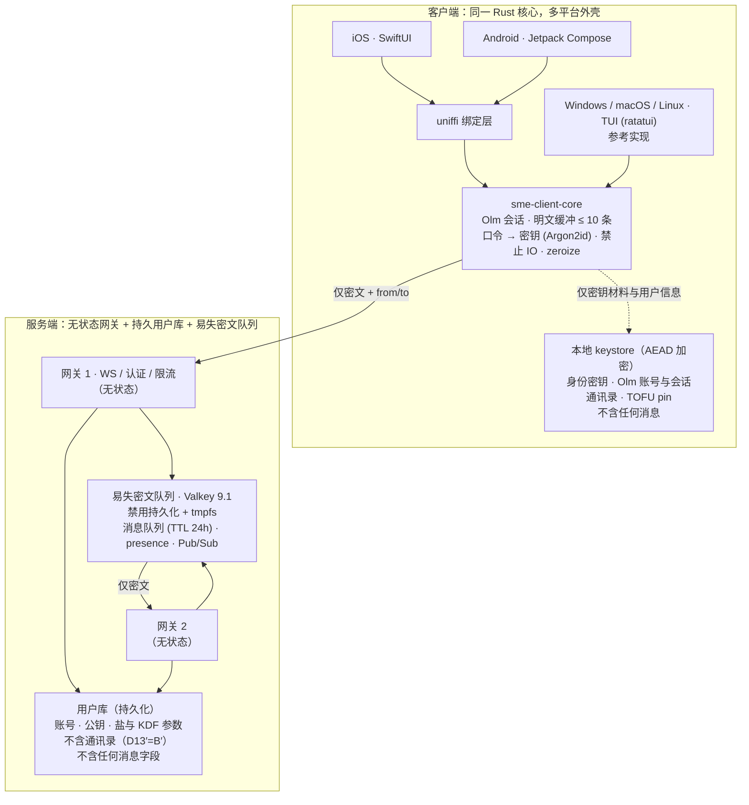

# sme — 端到端加密聊天软件 · 规划草案

> 状态：草案 v0.6
> 目标读者：本项目开发者
>
> - v0.2：D3 修订为全平台（iOS / Android / Windows / macOS / Linux，含 TUI）；D1、D2、D5、D6、D7、D8 确认。
> - v0.3：**保证范围收窄**为「本应用自身的写操作」，OS 换页/系统快照明确排除（§11）；服务端改为**可横向扩展**架构（§12.1，新增 D9/D10）；**`no_std` 核心不可行**（`vodozemac` 实测结论，见 §14），D4a–D4d 确认、D4e 关闭。
> - v0.4：**持久化策略重定义为「消息零落盘 + 用户信息可持久化」**（D13，§11）；服务端引入持久用户库；不变式重写并新增 I9（全链路金丝雀）、I10（pin 不可静默改写）；新增 D14（密钥材料是否算用户信息，决定 §6.1 分层是否保留）。
> - v0.5：**D14=A + D13′=B′ 确认**。密钥材料改为「随机生成一次 + 口令派生 KEK 加密落盘」，§6.1 的 D12 分层删除；**D2 修订**（会话状态不再纯内存）；新增 `sme-client-store` crate、不变式 I11；通讯录与 pin 改存客户端本地，服务端持久层只剩账号数据。
> - v0.6：v1 范围收敛为**文本 + 图片**（图片 ≤1MB，客户端压缩并剥离 EXIF；不支持文件与视频）；**取消 E2EE-ack 与已读回执**（D22：双方互相感知不到状态）；D7 修订为 TTL 24 小时 + 字节配额；确认 v1 不接入任何推送（D19）；新增 I12、`sme-media` crate；基础设施规格见 `docs/INFRA.md`。
> - v0.7：M0 落地（workspace 骨架 + 三条 CI 门禁 + compose/migration + I3/I11 测试）；新增 D23（keystore AEAD）与 D24（Argon2id 默认参数）。
> - v0.8：M1 完成——Olm 账号与会话经 KEK 加密跨重启恢复（条目 `olm.account` / `olm.session.<id>`），Argon2id 通过官方参考实现的 KAT。
> - v0.9：M2 起步——`sme-proto` 线路协议落地（账号 ID base32、控制帧 + Olm 信封、postcard 严格编解码）；查询方案选 A（D25），workspace MSRV 提到 1.94（sqlx 0.9 要求）。
> - v0.10：M2 完成——axum 网关（注册 / 挑战-签名登录 / 预密钥 / 密文转发 / 离线队列 / D-ack）、客户端核心状态机（Olm 握手、加解密、内存缓冲、持久化信号）与 WebSocket 传输；端到端测试覆盖离线队列与跨重启棘轮恢复。
> - v0.11：M3 完成——队列 / 预密钥 / 挑战 / presence / 限流全部进入 Valkey（D17 HMAC 键名、Stream TTL 24h、D-ack 原子删）；网关无状态；启动自检 I7；新增 I1/I5/I7/I8 不变式测试。
> - v0.12：M4 完成——ratatui 参考客户端（仅文本：`/peer` 选对端、Ctrl+X 紧急擦除、空闲锁定）；消息缓冲与会话全链路 `Zeroize`；I4（应用目录金丝雀扫描）与 I6（类型级 zeroize 契约 + wipe 语义）测试；新增 `LocalConfig`。
> - v0.13：产品调整——桌面三平台统一 TUI（D4a′ 修订，取消 egui/iced 路线；M6 改为平台适配）；代码注释全部改为英文。

## 1. 产品定位（一句话）

一个**可证明不在磁盘上留下任何消息痕迹**的端到端加密一对一聊天工具：服务端零知识、零持久化，客户端只在内存里保留极少量明文。

## 2. 明确的非目标（v1 不做）

| 非目标 | 原因 |
| --- | --- |
| 群聊 | 需要 MLS/发送者密钥；先做 1:1，把密码学链路打扎实 |
| 多设备同时在线 / 历史同步 | 与本项目「客户端不落盘」直接冲突（无历史可同步）。注意：**「多平台客户端」是目标，与「多设备同步」是两件事**（见 §11） |
| 历史消息、搜索、导出 | 与需求 2/3 冲突，是产品特性而非缺陷 |
| 消息编辑/撤回/已读回执持久化 | 需要服务端或客户端存状态 |
| 抗元数据（隐藏「谁和谁在何时通信」） | 需要 mixnet / P2P 打洞，属于另一条产品线 |
| 离线消息的长期存储 | 见决策 D1；v1 只做 24 小时内的临时暂存（仅内存，不落盘） |
| 文件与视频传输 | v1 只支持文本与图片（D21）。视频转码是一个独立项目（需平台原生编码器），留到 v2 |
| 匿名注册（无需身份） | 账号即公钥，仍需与联系人建立信任 |
| 操作系统层面的写盘（swap / zRAM / 系统快照 / 系统备份） | 已明确排除：只约束**本应用自身的写操作**（§11）。注意：本项排除的是「OS 替我们写」，与「我们主动写用户信息」是两件事 |
| 用户信息（账号、公钥、盐、通讯录、安全码 pin）的持久化 | **允许**（D13）。「不落盘」只针对**消息**（§11） |

> 注意：本工具的「不落盘」是**客户端策略**，不是法律豁免。分发与合规需按目标地区单独评估。

## 3. 三条设想带来的必然后果

先接受这三条推论，后面的架构才自洽：

1. **「服务端不保存聊天记录」≠ 消息一定送得到。** 接收方离线时，要么丢消息，要么服务端暂存密文。这是一个必须二选一的产品决策（D1）。
2. **「只缓存 10 条、不落盘、退出清空」意味着重启后对话是空白。** 没有历史 = 没有上下文，用户必须改变预期，UI 要显式告知（例如「历史已按策略丢弃」占位符，而非静默空白）。
3. **「消息不落盘」不能顺带约束「密钥状态」。** Double Ratchet 的链式密钥必须连续，否则无法解密后续消息。但消息缓冲 ≠ 会话状态：**丢弃消息不影响解密能力，丢弃会话状态则必须重新握手**（对应决策 D2）。

### 3.1 「清空」不是免费的

「客户端退出清空」在代码里等于**全进程不得持有消息字节**（用户信息除外，见 §11）。真正的工程工作量在于排查所有可能把**消息**带到磁盘上的旁路：

- 日志、panic/backtrace、core dump
- 系统 swap / 休眠（suspend-to-disk）
- TLS session ticket 缓存、DNS 缓存
- 剪贴板、系统通知中心、输入法词库
- 终端回滚缓冲 / tmux / screen 日志（桌面统一 TUI 后的字节旁路）
- 崩溃上报、遥测、自动更新残留

因此「无落盘」必须是一个**可验证的约束**（见 §7 不变式），而不是口号。

## 4. 架构总览



**关键点：明文只允许存在于两处** —— Rust 核心内的 10 条环形缓冲，以及渲染瞬间的 UI 层。UI 层是唯一无法被 `zeroize` 完全擦除的边界（操作系统与 UI 框架可能复制字符串），这一点要写进威胁模型（§11）。

**信任边界**

- 服务端可见：账号标识、在线状态、时间、密文长度、收发关系（元数据）。**不可见：消息明文、私钥、会话密钥。**
- 密文与元数据会在队列组件的内存中存在 ≤**24 小时**（§12.1）—— 这是查询「服务端到底能看到什么」时最关键的一条。
- 服务端持久保存：账号、公钥、口令盐与 KDF 参数。**不含通讯录（D13′=B′）与任何消息字段**（I1）。
- 服务端不可见的另一面：它也**无法做内容审核、无法恢复被丢弃的消息、无法处理用户投诉中的证据**。这是产品取舍。

## 5. 模块划分

依赖方向单向，越靠内层越「无副作用」：

```
Cargo workspace（Rust）
  crates/
    sme-crypto/        KEK 派生（Argon2id）、AEAD 封包、口令盐管理；纯函数 + 测试向量
    sme-media/         图片压缩与元数据剥离（EXIF/GPS/ICC）；纯字节变换，无 IO、无密码学
    sme-proto/         线路信封、版本协商、错误类型（与 server 共享同一套类型）
    sme-client-core/   会话管理、Olm 会话持有、重放窗口、10 条内存环形缓冲
    sme-client-store/  本地 keystore：加解密并读写密钥材料与用户信息（唯一允许写盘的客户端 crate）
    sme-client-net/    WebSocket 传输、重连、心跳（唯一允许网络的客户端 crate）
    sme-ffi/           uniffi 绑定层：导出给 Swift / Kotlin
    sme-client-tui/    桌面三平台参考客户端（Windows/macOS/Linux，ratatui，仅文本）
    sme-server/        axum 网关：认证、在线状态、共享队列访问、限流
  apps/
    ios/               SwiftUI 外壳：渲染 + 输入 + 平台生命周期
    android/           Jetpack Compose 外壳：同上
  docs/
    THREAT_MODEL.md    威胁模型与信任假设
    NO_STORAGE.md      「本应用零写盘」清单与逐平台审计记录
    TECH_STACK.md      D4 结论与理由
```

**关键约束**

- `sme-crypto` / `sme-proto` / `sme-client-core` 中**不允许出现文件、网络、进程 API**。密钥材料的读写集中到 `sme-client-store`，网络集中到 `sme-client-net`，由两道 CI 门禁强制：
  1. **静态门禁**：扫描禁词（`std::fs`、`std::net`、`std::process`、`std::env`、`File::create` …），命中即构建失败；
  2. **运行时门禁**：syscall 级断言（不变式 I4、I11）。
- 随机数回归 `getrandom` / `OsRng`，不再需要「宿主注入 RNG」带来的额外复杂度。
- 平台外壳只负责渲染、输入与系统生命周期钩子（前后台切换、锁屏快照遮蔽），不参与任何密码学；网络统一走 `sme-client-net`。

## 6. 协议与密码学

原则：**不造密码学。** 只做协议编排，不自己设计原语或握手。

- **会话与消息加密：`vodozemac` 的 Olm**（X25519 三方 DH 握手 + 双棘轮；对称原语由库决定，我们不自选）。前向保密与 post-compromise security 由双棘轮提供。
- **身份**：Ed25519 签名密钥 + Curve25519 身份密钥，均由 `vodozemac::olm::Account` 持有
- **安全码核对（D6）**：直接用 `vodozemac` 的 SAS 模块（emoji / 十进制短码），不自己设计
- **口令 → KEK**：`Argon2id`（`vodozemac` 不提供这一层，由 `sme-crypto` 实现；参数记录在文档中）。KEK 只用于加解密本地 keystore，身份密钥本身是随机生成的。
- **密钥材料持久化**：直接用 vodozemac 的 `pickle` / `AccountPickle::encrypt(kek)`，不需要自定义序列化。

### 6.1 密钥层次（D14=A：密钥材料可加密落盘）

用户信息与密钥材料允许持久化，但**必须是以口令派生密钥加密后的密文**。因此密钥层次变成：

| 层级 | 生命周期 | 来源 | 存放 |
| --- | --- | --- | --- |
| **口令** | 用户记忆 | —— | 不存 |
| **KEK**（密钥加密密钥） | 每次启动重新派生 | `Argon2id(口令, salt, params)` | 仅内存，用后 `zeroize` |
| **身份密钥**（Ed25519） | 长期 | **首次注册时随机生成一次** | 本地 keystore，AEAD 加密 |
| **Olm 账号** + prekey 私钥 | 长期（可轮换） | 首次注册随机生成 | 本地 keystore，加密 |
| **Olm 会话状态** | 长期（跨启动） | 握手产生 | 本地 keystore，加密 |
| 通讯录 / TOFU pin | 长期 | 用户添加 / 首次联系 | 本地 keystore，加密（D13′=B′） |
| **消息** | 本次运行 | 收发产生 | 仅内存，≤10 条，**永不落盘** |

关键点：

- **身份不再由口令派生**，而是随机生成后加密保存。于是：改口令 = 重新包裹 keystore（rekey），身份与安全码不变 → **协议 R1（身份不可轮换）消失**。
- **不再每次启动重握手**：Olm 账号与会话状态从 keystore 恢复（D2 修订，见 §10.1）。移动端进程被杀后也能接上。
- **vodozemac 原生能力直接可用**：`Account::pickle()` → `AccountPickle::encrypt(kek)` → 落盘；`AccountPickle::from_encrypted(...)` 恢复。会话同理。**不需要任何内部格式 hack。**
- **盐与账号 ID 记在本地**（keystore 旁的一个不含秘密的小配置）：解密不依赖服务端，服务端改盐只会导致登录失败，不会导致本地数据打不开。
- 登录仍为挑战–签名，签名密钥就是上面这个身份密钥。
- **代价**：磁盘上出现了密钥材料的密文。设备被扣押 + 口令弱 → 离线破解 KEK → 可恢复身份、通讯录**与当前会话**（但**历史消息仍然不存在**，因为消息从不落盘）。
- **红线不变**：keystore 里不允许出现任何消息字节（I11 验证）。

### 6.2 握手与登录

1. 客户端用口令 + 随机盐（盐可存服务端，非秘密）派生身份私钥，派生结果只在内存中。
2. 登录 = 服务端发随机挑战，客户端用 Ed25519 签名。**口令与私钥永不出网、服务端不存口令**（也省掉了口令哈希库的泄露风险）。
3. 每条消息的加密是独立的密文信封；服务端只做盲转发。

### 6.3 线路协议（M2 落地，实现见 `crates/sme-proto`）

控制帧与消息帧共用 postcard 编码；解码严格（拒绝多余字节、未知分支与超限字段），单帧 ≤ 1.2MB（`MAX_FRAME_BYTES`）。

- **控制帧**：`Register` / `ChallengeRequest` / `Challenge` / `Login` / `LoginAck` / `UploadPreKeys` / `FetchPreKey` / `PreKeyBundle` / `SendAck`（Q-ack）/ `DeliverAck`（D-ack）/ `Error`
- **消息帧 `Envelope`**：

| 字段 | 说明 |
| --- | --- |
| `v` | 协议版本，当前 `PROTOCOL_VERSION = 1` |
| `from` / `to` | 账号标识（服务端可见的元数据） |
| `sid` | Olm 会话 ID（客户端本地标识，便于路由与排障） |
| `kind` | Olm 消息种类：`PreKey` / `Normal` |
| `payload` | Olm 密文原始字节（≤1.1MB） |

修订说明（v0.9）：原草案的 `n` / `iv` 属于自设计信封；改用 vodozemac Olm 后，消息序号与 nonce 由 Olm 内部管理，不再出现在线路上。时间戳与内容一样留在密文里。

### 6.4 送达与确认（对应 D1）

在线直投优先；接收方离线时，服务端把**密文**放入共享易失队列（架构见 §12.1）：

- 每条带 TTL **24 小时**（D7 修订），过期即丢，不落盘、不重试无限次
- 收件人客户端回 **D-ack** 后立即删除（Lua 脚本原子删队列条目与图片兄弟键）
- 服务端不感知队列里装的是什么，只按 `to` 投递
- **队列是唯一事实来源**：发送时先入队，再通知持有该收件人连接的网关去读；Pub/Sub 通知丢失不影响可靠性（`docs/INFRA.md` §4.2）
- **只有两级 ACK，没有第三级**（D22）：
  - **Q-ack**（服务端 → 发送方）：密文已接管，发送方可释放待发副本。发送方**永远无法得知**对方是否收到、是否在线、是否读过
  - **D-ack**（接收方 → 服务端）：可以删队列了，仅用于回收内存与防重复投递
  - **不做 E2EE-ack、不做已读回执**：不让收发双方互相感知状态

## 7. 可验证的不变式（Invariants）

这是本项目区别于「声称安全」的关键部分。每条不变式都对应一个自动化测试。

| # | 不变式 | 验证方式 | 覆盖平台 |
| --- | --- | --- | --- |
| I1 | 服务端持久化层不含任何消息字段 | schema 断言（用户库不存在消息表/列）+ I9 金丝雀扫描 | 服务端 |
| I2 | 客户端核心代码不含文件/网络/进程 API | CI 静态禁词扫描（`std::fs` / `std::net` / `std::process` …），命中即失败 | 全平台（源码级） |
| I3 | 内存中明文消息条数 ≤ 10 | 单元测试：写入 100 条后断言缓冲长度与最旧内容 | 全平台 |
| I4 | 客户端写入磁盘的字节中不含消息内容 | 金丝雀 + 白名单审计（允许 keystore 与用户信息文件存在，但其内不得出现消息字符串） | 桌面 TUI（Windows/macOS/Linux）自动化；iOS/Android 用沙箱目录审计（§11） |
| I5 | 服务端日志不含消息内容 | 金丝雀字符串不出现在服务端任何输出流中 | 服务端 |
| I6 | 退出即擦除内存中的 KEK、口令与消息 | 全程 `zeroize`；断言析构顺序（`mlock` / 禁 core dump 为尽力项，非承诺） | 全平台 |
| I7 | 易失队列组件禁用持久化 | 服务端启动自检 `CONFIG GET save appendonly`，不满足则拒绝启动 | 服务端 |
| I8 | 易失队列重启后不残留密文 | 写入密文 → 重启组件 → 断言队列为空 | 服务端 |
| I9 | **全链路金丝雀**：消息不出现在任何磁盘、数据库、日志、转储中 | 发送唯一字符串 → 走完全生命周期（客户端退出/重启、服务端重启、用户库 dump、队列组件快照）→ 全盘 grep 必须为零 | 端到端 |
| I10 | 安全码 pin 不被静默改写 | 变更路径必须触发告警；测试断言 pin 变更事件被上报 | 客户端 |
| I11 | 落盘的 keystore 必须是密文，且不含任何消息字节 | 读取 keystore 文件，断言其中不含身份私钥明文与实例中出现过的消息字符串；断言无口令时无法解密 | 全平台 |
| I12 | 发出的图片不含 EXIF / GPS / ICC 元数据 | 单测：对带 GPS 的样例图跑压缩链路，断言输出中不存在 EXIF 段与坐标字节 | 全平台（`sme-media`） |

## 8. 消息缓冲策略（需求 2 的具体化）

- 环形缓冲上限定义为常量 `MESSAGE_BUFFER_LIMIT = 10`（可配置，默认 10，写进文档而非散落在代码里）
- 语义：**按到达顺序保留最近 10 条**。更早的被丢弃，不写盘、不进系统通知历史
- 界面必须有「中间有消息已被丢弃」的间隙提示，不能伪造连续对话
- 丢弃消息 ≠ 丢弃解密能力：棘轮状态独立于消息缓冲，仍然连续（见 §3 第 3 条）
- 送达 ACK 与显示缓冲解耦：即使某条消息因超限未显示，也必须回 D-ack，否则服务端会重复投递
- **图片受字节预算单独约束**：`ATTACHMENT_BYTES_LIMIT = 8MB`。超预算时优先淘汰最早的**图片**（文本继续保留），界面显示「图片已丢弃，需对方重发」——不可简单地用「10 条」去限制 1MB 级的图片

## 9. 里程碑

| 阶段 | 内容 | 退出标准 |
| --- | --- | --- |
| M0 | 威胁模型 + NO_STORAGE 策略 + workspace 骨架 + CI 门禁（I2 静态扫描） | `docs/THREAT_MODEL.md` 定稿；CI 跑通 `cargo test` 与禁词扫描 |
| M1 | crypto 与 keystore：KEK 派生（Argon2id）、身份密钥生成、Olm 账号与会话的加密落盘/恢复 | 两个进程走通「首次注册 → 退出 → 重启 → 身份与会话不变」；测试向量通过 |
| M2 | 接入 `sme-client-net` + 服务端，完成 1:1 实时聊天 | 端到端集成测试：服务端只见到密文；会话状态跨重启恢复 |
| M3 | 横向扩展改造：无状态网关 + 共享易失队列 + TTL + ACK 即删 + 限流 + 在线状态 + 启动自检 | 不变式 I1、I5、I7、I8 测试通过 |
| M4 | TUI 参考客户端（**仅文本**）+ 零消息落盘加固（`zeroize`、紧急擦除、syscall 断言） | 不变式 I2、I3、I4、I6、I11 测试通过（Linux/macOS/Windows） |
| M5 | 移动端：uniffi + iOS/Android 外壳 + `sme-media` 图片链路（压缩 / 剥离 EXIF / 解压炸弹防御）+ 平台加固（防快照） | 沙箱目录审计通过；I12 通过 |
| M6 | 桌面三平台（Windows/macOS/Linux）TUI 适配与平台审计（构建、数据目录、权限） | 三平台构建通过；复用 M4 的不变式测试 |
| M7（后续） | 安全码核对 UI（SAS）、群聊（Megolm/MLS）、元数据保护；**文件与视频**（平台原生编码器，不用 FFmpeg） | — |

## 10. 决策记录

### 10.1 已确认

| # | 决策 | 结论 |
| --- | --- | --- |
| **D1** | 接收方离线时 | 服务端暂存**密文**，TTL + ACK 即删 |
| **D2** | 棘轮会话状态 | ✅ **修订（v0.5，因 D14=A）**：以口令派生 KEK 加密落盘，跨启动恢复。原「纯内存、每次启动重握手」已废止 |
| **D3** | 客户端平台 | iOS / Android / Windows / macOS / Linux（含 TUI） |
| **D4a** | 客户端 UI 层 | 一套 Rust 核心 + 各平台原生外壳 |
| **D4b** | Rust ↔ 平台 FFI | `uniffi` |
| **D4c** | 服务端 | Rust（axum + tokio），与客户端共享 `sme-proto` |
| **D4d** | 线路序列化 | `postcard` |
| **D4e** | `no_std` 核心 | ❌ 不可行（§14 实测）；改为 std 核心 + 两道 CI 门禁 |
| **D5** | 密码学库 | `vodozemac` 0.11.x（Apache-2.0，便于闭源分发） |
| **D6** | 信任模型 | TOFU + 安全码核对（用其 SAS 模块） |
| **D7** | 队列 TTL / 上限 | ✅ **修订（v0.6）**：**24 小时**；每收件人 ≤100 条、图片 ≤10 张且 ≤12MB；全局 `maxmemory 1GB` + `noeviction` |
| **D8** | 清空触发时机 | 正常退出 / 崩溃 / 空闲锁定 / 紧急擦除快捷键，四种都要 |
| **D13** | 通讯录 / 用户信息 | ✅ 用户信息允许持久化（「不落盘」只针对消息） |
| **D13′** | 通讯录与 pin 存放位置 | ✅ **客户端本地 keystore**；服务端持久层只剩账号、公钥、盐与 KDF 参数 |
| **D14** | 密钥材料归属 | ✅ 算「用户信息」，可加密落盘（KEK 由 Argon2id 派生） |
| **D11** | 持久化范围 | **消息零落盘（客户端与服务端都是）+ 用户信息可持久化**（§11） |
| **D9** | 横向扩展方式 | 无状态网关 + 禁用持久化的共享易失队列（§12.1） |
| **D10** | 同账号并发登录 | 单会话：新登录踢掉旧会话 |
| **D4a′** | 桌面客户端形式 | ✅ **修订（v0.13）**：Windows / macOS / Linux 统一使用 TUI 参考客户端（ratatui），不再另做 GUI。理由：一套实现 + 与「明文只存在于内存缓冲」的约束最一致，也避免了 WebView 缓存旁路 |
| **D16** | 账号 ID 形态 | 128-bit 随机，base32 26 字符（防用户名枚举） |
| **D17** | Valkey 键与频道名 | 一律用 `HMAC(服务端密钥, 账号ID)`，运维看不到谁在等谁的消息 |
| **D18** | TLS 终止 | Caddy 反代（自动证书） |
| **D19** | 推送服务 | ✅ **v1 不接入任何推送**：FCM 在国内不可用，各厂商 SDK 与隐私定位冲突；只在用户打开应用时收到消息 |
| **D21** | 消息类型范围 | ✅ **v1 只支持文本 + 图片**：文本 ≤16KB，图片压缩后 ≤1MB；**不支持文件与视频**（留待 v2） |
| **D22** | ACK 与状态感知 | ✅ 只有 Q-ack 与 D-ack，**无 E2EE-ack、无已读回执、无 presence 展示**：收发双方互相推断不到对方状态 |
| **D23** | 本地 keystore 的 AEAD 原语 | ✅ **ChaCha20-Poly1305**（RustCrypto `chacha20poly1305`）：随机 96-bit nonce 附在密文前，AAD = keystore 头部；**不使用** vodozemac `hazmat::Cipher`（其 IV 由密钥确定性导出，只适用于一次性消息密钥） |
| **D24** | Argon2id 默认参数 | ✅ OWASP 第一档：`m_cost = 19456 KiB, t_cost = 2, p_cost = 1`；参数随 keystore 头保存，将来可升级并重包裹 |
| **D25** | sqlx 查询方式 | ✅ 方案 A：运行时 `query_as` + `migrate!`（不需要 sqlx-cli，不提交 `.sqlx`）；M2 迭代快，查询面稳定后再评估切编译期宏。sqlx 0.9 要求 MSRV ≥ 1.94，workspace 已同步 |

### 10.2 待定

无待定项。M4 已完成（v0.12），桌面统一 TUI 见 D4a′ 的 v0.13 修订；下一步 M5。

## 11. 持久化策略（D11 / D13）

一句话：**消息零落盘，用户信息可持久化。**

**图片属于消息**（D21）：压缩后的图片字节与文本一样永不落盘。唯一出口是用户**显式「另存为」**——写出的是解密后的明文，写到用户自己选择的目录，属于用户主动行为；应用自身的目录与系统临时目录不得出现任何图片副本（I4/I11 金丝雀覆盖这两处）。

| 类别 | 具体内容 | 能否持久化 | 存放位置 |
| --- | --- | --- | --- |
| **消息（P1：禁止）** | 明文、密文、解密后的内容、消息顺序与时间、任何以消息为明文的加密产物 | ❌ 永不落盘 | 仅内存（≤10 条/端）；服务端仅易失队列 |
| **用户信息（P2：允许）** | 账号 ID、口令盐与 Argon2id 参数、公钥、prekey、通讯录、安全码 / TOFU pin | ✅ 允许 | 账号/公钥/盐在服务端；通讯录与 pin 在客户端 keystore（D13′=B′） |
| **密钥材料（P3：允许，但必须加密）** | 长期身份私钥、Olm 账号 pickle、棘轮状态 | ✅ 允许（AEAD 密文） | 客户端 `sme-client-store`，密钥 = 口令派生 KEK |

**逐平台审计方式**（审计目标从「零写入」改为「写入的字节里没有消息」）：

| 平台 | 允许的写入面 | 审计方式 |
| --- | --- | --- |
| **Linux / TUI**（参考实现） | keystore（加密）+ 本地配置（无秘密） | ① `strace` 白名单断言；② 金丝雀：发一条唯一字符串 → 退出 → 搜所有被写文件（I4、I9、I11） |
| **Windows / macOS 桌面** | 同上 | Process Monitor / `fs_usage`，等价的 syscall 白名单断言 |
| **iOS** | App 沙箱容器 | `xcrun simctl get_app_container` 快照对比 + 容器内金丝雀搜索 |
| **Android** | 内部存储 + 外部存储 | `adb shell run-as <pkg> ls -laR` + 沙箱内金丝雀搜索 |
| **服务端** | 用户库（账号/公钥/盐/参数/通讯录） | schema 断言（无消息字段）+ 数据库文件金丝雀搜索（I1、I9） |

### 11.1 为什么「消息零落盘」仍然很有价值

它把攻击面和取证面一起砍掉：设备被扣押、服务端被入侵、备份被拿到、磁盘被带走，**都搜不到任何聊天内容**。而用户信息落盘不影响这个结论（通讯录被拿到 ≈ 对方知道你认识谁，消息被拿到 = 对话内容全暴露）。二者不是一个量级的秘密。

### 11.2 平台加固（尽力项）

- **防快照**：Android `FLAG_SECURE`（同时拦住截图与最近任务快照）；iOS 在 `scenePhase` 转后台时用遮罩视图覆盖
- **通知**：内容必须泛化（「有一条新的加密消息」），推送载荷只作唤醒信号，**绝不携带消息体**
- **日志**：release 构建剥离全部日志；不接入任何崩溃上报 SDK；服务端禁用请求体日志

### 11.3 移动端带来的产品现实

D2 修订后，会话状态可跨启动恢复，移动端进程被杀不再意味重新握手。但**口令仍需每次启动重新输入**（KEK 不缓存到内存以外），因此移动端推送通知依旧是「唤醒信号」。

## 12. 技术栈（D4 结论）

| # | 子决策 | 结论 |
| --- | --- | --- |
| **D4a** | 客户端 UI 层 | 一套 Rust 核心 + 各平台外壳（移动端 SwiftUI / Compose；桌面三平台统一 ratatui TUI，见 D4a′）。舍弃 Flutter 与 React Native：额外运行时的字符串不可擦除，GC 与框架自身缓存行为不可控 |
| **D4b** | Rust ↔ 平台 FFI | `uniffi`（一份接口生成 Swift + Kotlin 绑定），路径已被 matrix-rust-sdk 验证 |
| **D4c** | 服务端 | Rust（axum + tokio），与客户端共享 `sme-proto` 类型 |
| **D4d** | 线路序列化 | `postcard`；解析必须严格（拒绝未知字段、限制长度），密码学代码不依赖 serde |
| **D4e** | `no_std` 核心 | ❌ 关闭，实测结论见 §14 |
| **D4a′** | 桌面客户端形式 | ✅ 修订（v0.13）：Windows / macOS / Linux 统一 TUI（ratatui） |

### 12.1 服务端横向扩展（D9）

前提：需求 1 约束的是「不保存聊天记录」，而 D1 已确认允许**短暂暂存密文**；D13 又允许持久化用户信息。因此服务端分成两种存储角色：

- **持久用户库**（SQLite / Postgres）：账号、公钥、口令盐与 KDF 参数。**不含通讯录（D13′=B′）、不含任何消息字段。**
- **易失密文队列**（Valkey 9.1，禁用持久化 + tmpfs，`maxmemory 1GB` + `noeviction`）：**所有**密文（不区分在线/离线）先入队，外加 presence、prekey、登录挑战、限流。

两者共性：网关都是**无状态**的，所以横向扩展只需在网关前面加一层负载均衡。

| 方案 | 做法 | 优点 | 代价 |
| --- | --- | --- | --- |
| **A. 无状态网关 + 共享易失队列**（建议） | WebSocket 网关完全无状态；所有密文先入队（Valkey Stream，TTL 24h），Pub/Sub 仅用于低延迟地通知持有该连接的网关去读；presence、prekey、限流也都在同一组件里 | 网关随连接数线性扩展；TTL 原生支持；运维标准化 | 多一个组件；必须硬性保证它不落盘（I7）+ 数据目录挂 tmpfs；组件重启会丢 ≤5 分钟内未投递的密文 |
| B. 一致性哈希分片 + 2 副本，无共享存储 | 按收件人做 rendezvous hash 决定 home 节点，密文只在该节点进程内存 | 密文从不离开进程内存，语义最纯 | 需自建成员管理与故障转移；节点变动时客户端需重连重投；实现与运维复杂度显著更高 |
| C. P2P（WebRTC），服务端只做信令 | 消息不经服务端 | 元数据最少、服务端几乎无状态 | 移动端后台无法维持 P2P；NAT 打洞失败率；与「应用随时会被系统杀掉」冲突 |

**选 A**，并落以下约束：

1. 队列组件以 `--save "" --appendonly no` 启动，数据目录挂 tmpfs（双保险：即使误配，写也只发生在内存）。
2. 网关启动时自检 `CONFIG GET save appendonly`，不满足即拒绝启动（I7）。
3. 集成测试：写入密文 → 重启队列组件 → 断言为空（I8）。
4. 语义边界：队列里只有密文、TTL 24 小时、D-ack 即删，因此仍满足「服务端不保存聊天记录」；但它把 **from/to 元数据**交给了一个额外的内存组件，这一点必须写进威胁模型。通讯录与 pin 已改存客户端本地（D13′=B′），服务端持久层不再有社交图谱。
5. 失效语义：网关或队列组件重启，会丢失 ≤**24 小时内**尚未投递的密文。D1 本身就选择了「宁可丢也不长期存」，二者一致 —— 但 UI 要如实告知「消息最多暂存 24 小时，对方未在此期间打开应用则永久丢失，且你无法得知」。

### 12.2 同账号并发登录（D10）

单会话：新登录踢掉旧会话，并在旧客户端给出明确提示。理由见 §10.2。

## 13. 下一步

1. 规划阶段完成：三份文档定稿、无待定项。
   - `plan.md` — 决策记录与不变式
   - `docs/THREAT_MODEL.md` — 威胁模型与残余风险
   - `docs/INFRA.md` — 基础设施规格（Postgres 18.6 / Valkey 9.1.2 / Caddy / 配额 / compose）
2. M0 ✅（v0.7）：workspace 骨架、三条 CI 门禁（I1 字段名 / I2 核心禁词 / Valkey 禁持久化，均含注入自检）、compose + `accounts` migration、I3/I11 测试。
3. M1 ✅（v0.8）：Olm 账号/会话跨重启恢复（`sme-client-store::save_account` / `load_account` / `save_session` / `load_sessions`，走 vodozemac 公开 pickle API），Argon2id KAT（含 p>1 向量）。
4. M2 ✅（v0.10）：`sme-proto` 线路协议；axum 网关（注册 / 挑战-签名登录 / 预密钥 / 密文转发 / 内存队列 / D-ack / 单会话顶替）；`sme-client-core` 状态机与 `sme-client-net` WebSocket 传输；端到端测试覆盖离线队列与跨重启恢复。
5. M3 ✅（v0.11）：Valkey 无状态网关（Stream TTL 24h、D-ack 原子删、D17 HMAC 键名、预密钥 7d、presence 心跳、限流、大消息信号量）；启动自检 I7；I1/I5/I7/I8 不变式测试（含真实 Valkey 重启验证）。
6. M4 ✅（v0.12）：ratatui 参考客户端（仅文本；`/peer` 切换对端、Ctrl+X 紧急擦除、空闲 5 分钟锁定）；明文缓冲与会话 `Zeroize`；I4 应用目录金丝雀扫描与 I6 类型契约测试；`LocalConfig` 保存账号 ID / 盐 / KDF 参数。
7. 下一步进 M5：uniffi + iOS/Android 外壳 + `sme-media` 图片链路（压缩 / 剥 EXIF / 解压炸弹防御）+ 平台防快照加固，补齐 I12。
8. 工具链与容器环境均已就绪（rustup stable + rustfmt/clippy；Docker 29.8 + Compose v5.6）。

## 14. 附录：D4e 验证记录与本地环境

### 14.1 实测结论：`vodozemac` 不是 `no_std`

验证方式（下载 0.11.1 源码到 `/tmp` 后做**只读**静态检查，未安装任何软件）：

```bash
cd /tmp && curl -sS -o v.crate https://static.crates.io/crates/vodozemac/vodozemac-0.11.1.crate
tar xzf v.crate && cd vodozemac-0.11.1
grep -rc "no_std" src/ | grep -v ':0' | wc -l   # → 0
grep -ro "std::" src/ | wc -l                   # → 92（分布在 45 个源文件中的 22 个）
```

证据：

- `src/lib.rs` 无 `#![no_std]`，全仓库零处 `no_std` 声明；
- 无条件使用 `std::fmt` / `std::io` / `std::collections` / `std::error`；
- 依赖 `base64ct` 显式开启 `"std"`，另有 `serde_json`、`prost`、`rand`、`thiserror` 等 std 依赖；
- 附带信息：`license = "Apache-2.0"`（满足 D5 的许可要求），`rust-version = "1.89"`，edition 2024。

**结论**：D4e 选项 A（`no_std` 核心 + `vodozemac`）不可行。采用 std 核心 + 两道 CI 门禁（§5）。若将来一定要 `no_std`，只能改用 RustCrypto 原语自行编排协议 —— 考虑到 D5 已确认不自研密码学，不建议。

### 14.2 本机环境探测结果

| 检查项 | 结果 |
| --- | --- |
| Rust 工具链 | **未安装**（`rustc` / `cargo` / `rustup` 均不存在） |
| 代理 | `http_proxy` / `https_proxy` = `http://172.19.16.1:7890` |
| DNS | 正常解析 `crates.io` / `index.crates.io` / `static.crates.io` |
| `index.crates.io/config.json` | 200 |
| `static.crates.io/.../*.crate` | 200（cargo 拉包可用） |
| `sh.rustup.rs` | 200（可安装工具链） |
| `https://crates.io/api/...` | 403 —— **仅因缺少 User-Agent**，加 UA 后 200；cargo 自带 UA，不影响使用 |

### 14.3 需要你手动执行的安装命令

按项目约定我不代你安装。代理已在环境变量中，cargo / rustup 会自动使用：

```bash
curl --proto '=https' --tlsv1.2 -sSf https://sh.rustup.rs | sh -s -- -y --default-toolchain stable
. "$HOME/.cargo/env"
rustc -V && cargo -V
```

当前代理可用，无需配置国内镜像；若日后拉包慢再考虑（需改 `~/.cargo/config.toml`）。

### 14.4 如果你想自己复现 D4e 判定

```bash
cd /tmp && curl -sS -o v.crate https://static.crates.io/crates/vodozemac/vodozemac-0.11.1.crate && tar xzf v.crate
cd vodozemac-0.11.1 && grep -rn "no_std" src/ ; grep -ro "std::" src/ | wc -l

# 装好工具链后做编译级验证（客观证明它在无 std 目标上编译不过）
cargo new --lib /tmp/probe && cd /tmp/probe && cargo add vodozemac
printf '#![no_std]\npub fn f() { let _ = vodozemac::olm::Account::new(); }\n' > src/lib.rs
rustup target add thumbv7em-none-eabi
cargo build --target thumbv7em-none-eabi 2>&1 | tail -5   # 预期：can't find crate for `std`
```

### 14.5 实测结论：`vodozemac` 的身份密钥无法注入自有密钥

这一项原本决定 D12 分层方案（口令重建身份）能否落地。逐项检查公开 API：

| 检查项 | 结果 |
| --- | --- |
| `Account::new()` | 内部直接调 `Ed25519Keypair::new()` / `Curve25519Keypair::new()`，均为随机生成，**不接受 RNG 参数** |
| `Ed25519Keypair::from_unexpanded_key()` | `pub(crate)` —— 外部不可用 |
| `Curve25519Keypair::from_secret_key()` | `pub(crate)` —— 外部不可用 |
| `AccountPickle` | `pub` 且实现 `Deserialize`，但字段私有；内部 pickle 类型位于私有模块 `mod types`（如 `Ed25519KeypairPickle`），外部**无法命名** |
| `hazmat` 模块 | 对 Olm 只导出一个 `MessageKey`，无密钥注入能力 |

**结论**：公开 API 下不存在「用自有密钥构造身份」的路径。唯一绕过手段是手写 JSON 灌进 `AccountPickle` 的反序列化，依赖内部私有格式 —— 不可接受。

**结论**：公开 API 下不存在「用自有密钥构造身份」的路径，唯一绕过手段是手写 JSON 灌进 `AccountPickle` 的反序列化 —— 永远不要试图往 vodozemac 里注入自选密钥。

好在 D14=A 之后这个问题不再需要解决：身份随机生成一次，连同 Olm 账号与会话状态一起用 `AccountPickle::encrypt(kek)` 加密落盘，全程都是公开 API（§6.1）。本附录保留此判定，作为「不碰内部序列化格式」的论证依据。
